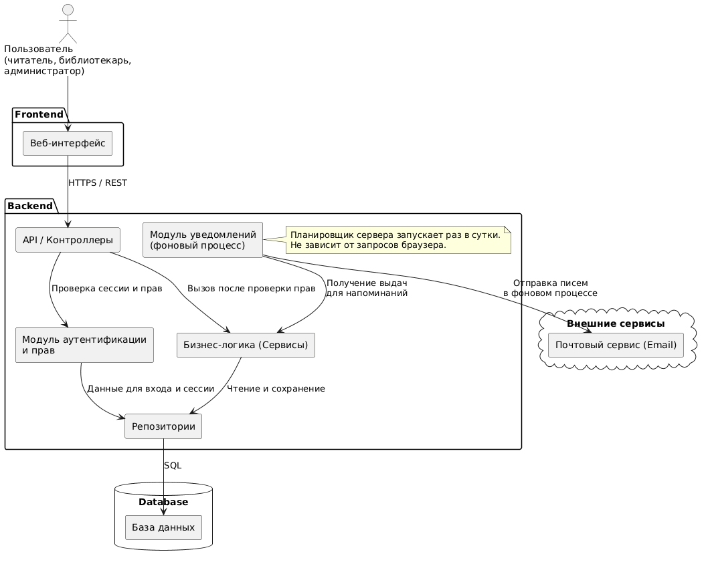
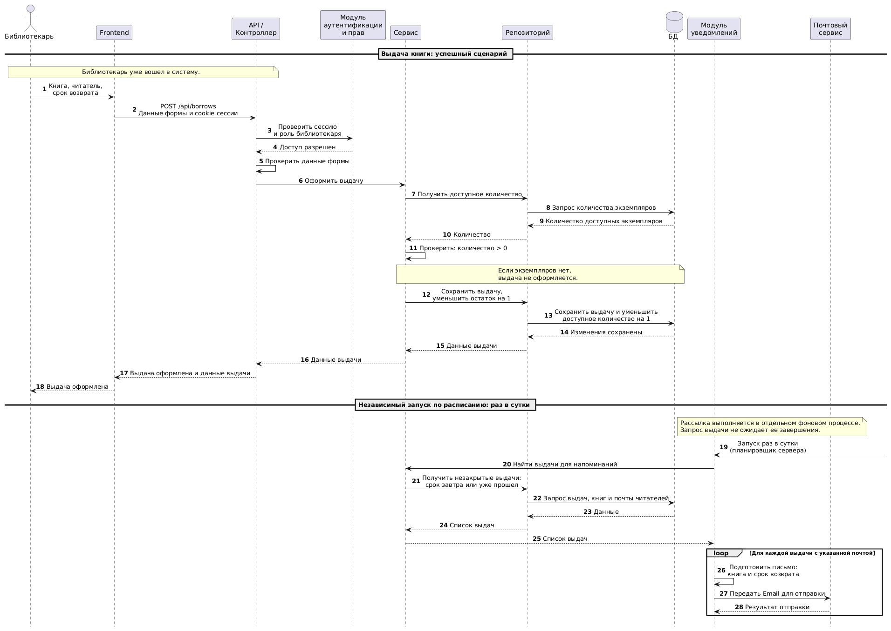

# Лабораторная работа №3: Проектирование архитектуры информационной системы

**Цель работы:** Изучить принципы проектирования архитектуры веб-приложений, спроектировать взаимодействие между компонентами системы с учетом индивидуальной особенности (асинхронных уведомлений) и подготовить структуру проекта для дальнейшей разработки.

---

## 1. Архитектура приложения

Для системы учета библиотечного фонда выбрана **трехуровневая веб-архитектура (3-tier)**:
* **Frontend (Клиентская часть):** Веб-интерфейс для взаимодействия пользователей с системой.
* **Backend (Серверная часть):** Принимает запросы, проверяет права пользователей и выполняет правила работы библиотеки.
* **Database (База данных):** Хранит данные о книгах, авторах, читателях, выдачах и учетных записях.

Приложение работает в браузере. Три уровня разделяют страницы сайта, обработку запросов и хранение данных. Поэтому интерфейс можно менять, не смешивая его код с правилами выдачи книг и запросами к базе данных.

---

## 2. Компоненты системы

Серверная часть разделена на следующие компоненты:
* **Маршрутизация и контроллеры (API):** Принимают HTTP-запросы интерфейса, проверяют входные данные, вызывают нужные сервисы и возвращают результат.
* **Модуль аутентификации и прав:** Проверяет логин и пароль при входе, создает сессию пользователя. При следующих запросах проверяет сессию и право выполнять действие.
* **Сервисы:** Реализуют правила работы с каталогом и авторами, читателями, выдачами и возвратами, списком должников и аккаунтами сотрудников.
* **Репозитории:** Отвечают за прямое взаимодействие с базой данных (выполнение SQL-запросов).
* **Модуль уведомлений:** В фоновом процессе получает от сервиса выдачи с подходящими сроками, формирует письма и передает их внешнему почтовому сервису.

**Внешний почтовый сервис** отправляет Email читателям. Он находится за пределами приложения. Для уведомлений выбран один канал - электронная почта.

Сохраняются три роли из предыдущих работ: читатель, библиотекарь и администратор. Читатель ищет книги и смотрит свои выдачи. Библиотекарь работает с каталогом и читателями, оформляет выдачу и возврат, смотрит должников. Администратор управляет аккаунтами сотрудников. Проверка прав выполняется на сервере до вызова нужного сервиса.

---

## 3. Взаимодействие компонентов

Последовательность оформления выдачи книги:

1. Библиотекарь входит в систему и заполняет форму: выбирает читателя, книгу и срок возврата.
2. Веб-интерфейс отправляет запрос `POST /api/borrows` с этими данными. С запросом передается cookie сессии.
3. Контроллер через модуль аутентификации и прав проверяет сессию и роль библиотекаря. Если пользователь не вошел, сервер возвращает сообщение «Требуется вход». Если у него нет права на действие, возвращается сообщение «Недостаточно прав».
4. Контроллер проверяет данные формы и передает их сервису выдачи. При ошибке возвращается сообщение «Неверные данные».
5. Сервис через репозиторий начинает транзакцию и получает количество доступных экземпляров с блокировкой записи книги. Если экземпляров нет, транзакция отменяется и сервер возвращает сообщение «Книга недоступна».
6. Если книга доступна, сервис через репозиторий сохраняет выдачу: книгу, читателя, библиотекаря, дату выдачи и срок возврата. Количество доступных экземпляров уменьшается на один, транзакция завершается.
7. Сервер возвращает результат «Выдача оформлена» и данные выдачи, интерфейс показывает результат. Отправку писем этот запрос не запускает и не ожидает.

Проверка остатка, сохранение выдачи и уменьшение количества выполняются в одной транзакции. Это значит, что изменения сохраняются вместе или полностью отменяются. Блокировка записи книги не позволяет двум запросам одновременно выдать последний экземпляр.

При возврате библиотекарь отмечает выдачу как закрытую, а количество доступных экземпляров увеличивается на один. Эти изменения также сохраняются вместе. Повторная отметка уже закрытой выдачи не увеличивает количество книг.

---

## 4. Индивидуальная особенность предметной области

В системе выделена нетиповая особенность - **автоматические Email-уведомления о сроках возврата книг и просрочке**. Она развивает контроль сроков. Напоминания помогают читателю вовремя вернуть книгу, а библиотекарю - меньше заниматься напоминаниями вручную. За эту функцию отвечает модуль уведомлений. Для нее к данным читателя добавляется электронная почта. Письма отправляются читателям, у которых она указана.

Порядок работы:

1. Планировщик сервера раз в сутки запускает отдельный фоновый процесс модуля уведомлений. Он работает без запроса из браузера.
2. Модуль вызывает сервис, который через репозиторий получает незакрытые выдачи: срок возврата наступает завтра или уже прошел. Возвращенные книги в рассылку не попадают.
3. Для каждой такой выдачи с указанной почтой модуль формирует письмо с названием книги и сроком возврата, затем передает его внешнему почтовому сервису.

Это асинхронная работа по отношению к запросам пользователей: рассылка запускается отдельно и не входит в обработку выдачи книги. Обмен с почтовым сервисом может занять время, поэтому сервер возвращает результат выдачи сразу после сохранения данных. Сбой отправки письма не отменяет уже оформленную выдачу.

---

## 5. Диаграммы и схемы

### Диаграмма архитектуры системы



*Исходник:* [`diagrams/architecture.puml`](./diagrams/architecture.puml)

**Описание:** Пользователь работает через веб-интерфейс. API проверяет сессию и права, затем вызывает сервисы. Доступ к базе данных выполняется через репозитории. Модуль уведомлений запускается по расписанию, получает данные через сервисы и обращается к внешнему почтовому сервису.

### Диаграмма взаимодействия компонентов (Sequence Diagram)



*Исходник:* [`diagrams/sequence.puml`](./diagrams/sequence.puml)

**Описание:** В первой части показана успешная выдача книги: проверка прав, проверка количества и сохранение изменений. Библиотекарь уже вошел в систему, данные формы корректны. Во второй части показан отдельный запуск рассылки по расписанию. Он не является продолжением запроса выдачи и выполняется без участия пользователя.

---

## 6. Структура будущего приложения

Планируется следующая структура.

```text
project/
├── frontend/
├── backend/
│   ├── routes/
│   ├── controllers/
│   ├── auth/
│   ├── services/
│   ├── repositories/
│   ├── models/
│   └── notifications/
├── database/
├── docs/
└── README.md
```

| Папка | Назначение |
|---|---|
| `frontend/` | Страницы каталога, личного кабинета и формы для работы библиотекаря и администратора. |
| `backend/routes/` | Связь адресов API с методами контроллеров. |
| `backend/controllers/` | Прием запросов, проверка данных и формирование ответов. |
| `backend/auth/` | Вход пользователей, работа с сессиями и проверка прав. |
| `backend/services/` | Правила работы библиотеки, включая выдачу, возврат и проверку сроков. |
| `backend/repositories/` | SQL-запросы и работа с транзакциями. |
| `backend/models/` | Описание данных книг, авторов, читателей, выдач и учетных записей. |
| `backend/notifications/` | Фоновая проверка сроков, формирование и отправка писем. Этот код запускает планировщик сервера. |
| `database/` | Скрипты создания таблиц базы данных. |
| `docs/` | Описание архитектуры и API, исходники и изображения диаграмм. |

---

## 7. Описание REST API

Описание API добавлено по разделу задания «Домашняя доработка». Интерфейс передает данные и получает ответы в формате JSON. После входа пользователь обращается к API с cookie сессии. Сервер проверяет права для каждого запроса; читатель получает только свои выдачи.

| Метод и адрес | Кто использует | Данные запроса и результат |
|---|---|---|
| `POST /api/login` | Все роли | Логин и пароль. Создает сессию и возвращает роль пользователя. |
| `GET /api/books` | Читатель, библиотекарь | Поиск по названию, автору или жанру. Возвращает книги и количество доступных экземпляров. |
| `POST /api/books` | Библиотекарь | Название, авторы, год, жанр и количество экземпляров. Добавляет книгу. |
| `PATCH /api/books/{id}` | Библиотекарь | Изменяемые поля книги. Обновляет ее описание и количество экземпляров с учетом активных выдач. |
| `POST /api/authors`, `PATCH /api/authors/{id}` | Библиотекарь | Данные автора. Добавляет автора или изменяет его описание. |
| `POST /api/readers` | Библиотекарь | ФИО, номер билета, телефон, данные для входа и Email для напоминаний, если он указан. Регистрирует читателя. |
| `GET /api/readers` | Библиотекарь | Поиск по ФИО или ID для выбора читателя при выдаче. Возвращает найденных читателей. |
| `GET /api/borrows?mine=true` | Читатель | Возвращает его текущие выдачи и сроки возврата. |
| `POST /api/borrows` | Библиотекарь | ID книги, ID читателя, срок возврата. Сохраняет выдачу и уменьшает доступное количество. |
| `PATCH /api/borrows/{id}/return` | Библиотекарь | ID выдачи в адресе. Отмечает возврат и увеличивает доступное количество один раз. |
| `GET /api/borrows?overdue=true` | Библиотекарь | Возвращает незакрытые просроченные выдачи с данными книг и читателей. |
| `POST /api/staff`, `PATCH /api/staff/{id}`, `DELETE /api/staff/{id}` | Администратор | Данные учетной записи сотрудника. Создает, изменяет или удаляет аккаунт. |

При успешном запросе сервер возвращает данные или подтверждение действия. При ошибке возвращается понятное сообщение: «Требуется вход», «Недостаточно прав», «Неверные данные», «Запись не найдена» или «Книга недоступна».

---

## Вывод
Спроектирована трехуровневая архитектура системы учета библиотечного фонда. Описаны компоненты, проверка прав, выдача и возврат книг, фоновая отправка напоминаний. Подготовлены диаграммы, структура будущего приложения и краткое описание REST API.
