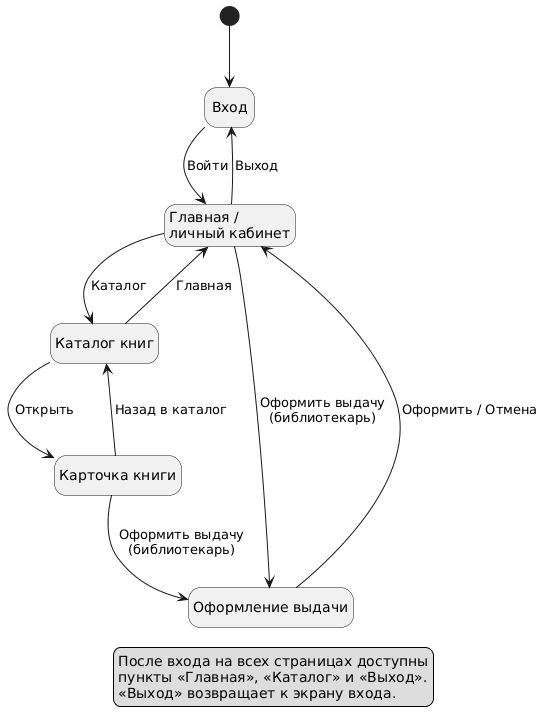
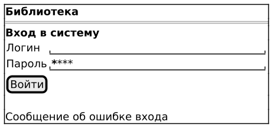
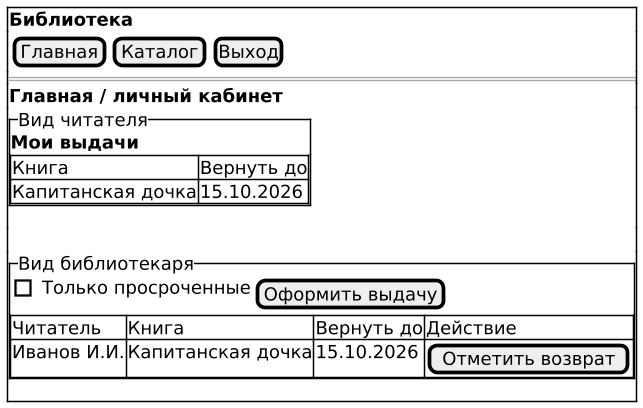
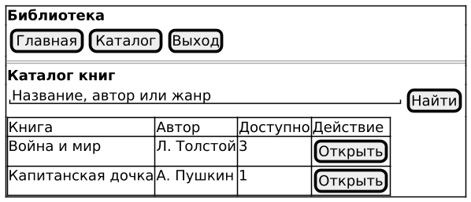
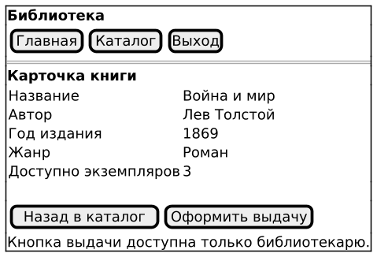
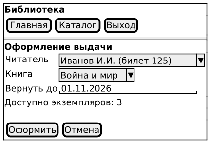

# Лабораторная работа №4
## Проектирование пользовательского интерфейса

**Цель работы:** Определить экраны системы учета книг библиотеки, спроектировать навигацию и подготовить простые макеты страниц.

## 1. Структура пользовательского интерфейса

Подготовлено пять основных экранов. Макеты выполнены в PlantUML Salt в виде wireframe. Они показывают расположение элементов без подробного оформления.

| Экран | Назначение | Основные элементы | Действия пользователя |
|---|---|---|---|
| Вход | Войти в систему | Поля логина и пароля, кнопка входа | Ввести данные и нажать «Войти». |
| Главная / личный кабинет | Просматривать выдачи | Меню, таблица выдач, элементы управления по роли | Смотреть сроки; библиотекарю также доступны выдача, возврат и фильтр просрочки. |
| Каталог книг | Найти доступную книгу | Строка поиска, таблица книг с авторами и количеством | Найти книгу по названию, автору или жанру, открыть карточку. |
| Карточка книги | Посмотреть сведения о книге | Название, автор, год, жанр, доступное количество | Вернуться в каталог; библиотекарю доступно оформление выдачи. |
| Оформление выдачи | Записать выдачу книги читателю | Выбор читателя и книги, срок возврата, кнопки формы | Оформить выдачу или отменить действие. |

Роль определяется при входе. Читатель видит только свои выдачи. Библиотекарь видит выдачи всех читателей и может оформлять выдачу и возврат. Кнопки этих действий читателю недоступны.

## 2. Навигация между экранами

После входа открывается главная страница. Из меню можно перейти в каталог, а из списка книг открыть карточку. Библиотекарь переходит к оформлению выдачи с главной страницы или из карточки книги. Во втором случае книга уже выбрана.

После оформления выдачи или нажатия «Отмена» открывается главная страница. В карточке есть кнопка «Назад в каталог». На всех страницах после входа доступны пункты «Главная», «Каталог» и «Выход». Выход возвращает к форме входа.

Исходник: [navigation.puml](diagrams/navigation.puml).

Схема показывает основные переходы. Общие пункты меню не продублированы стрелками от каждого экрана.

## 3. Макеты экранов

### Вход

Пользователь вводит логин и пароль. При неверных данных сообщение появляется под формой.

Исходник: [login.puml](design/login.puml).

### Главная / личный кабинет

Два блока показывают варианты одной страницы. Пользователю отображается только блок его роли. Читатель смотрит свои выдачи и сроки. Библиотекарь может отфильтровать просроченные выдачи, отметить возврат или открыть форму выдачи.

Исходник: [home.puml](design/home.puml).

### Каталог книг

Поиск и результаты находятся на одной странице. Рядом с каждой книгой указано доступное количество и есть кнопка «Открыть».

Исходник: [catalog.puml](design/catalog.puml).

### Карточка книги

Карточка показывает сведения о книге. Кнопка «Оформить выдачу» доступна только библиотекарю и только при наличии свободного экземпляра.

Исходник: [book-details.puml](design/book-details.puml).

### Оформление выдачи

Библиотекарь выбирает читателя, книгу и срок возврата. Перед сохранением сервер проверяет данные и доступность книги. После успешного оформления на главной странице появляется сообщение «Выдача оформлена».

Исходник: [borrow-form.puml](design/borrow-form.puml).

## 4. Решения по организации интерфейса

* После входа страницы имеют одинаковую шапку и меню. Основные кнопки подписаны действиями: «Найти», «Открыть», «Оформить», «Отмена».
* Поиск расположен над списком книг. Из карточки можно сразу перейти к выдаче без повторного выбора книги.
* Ошибки показываются рядом с формой: «Неверный логин или пароль», «Укажите срок возврата», «Книга недоступна». Если поиск не дал результатов, выводится «Книги не найдены».
* Успешный возврат закрывает выдачу и обновляет список на главной странице. Библиотекарь видит подтверждение «Возврат отмечен».

## 5. Основные запросы API

Интерфейс передает запросы серверу и получает данные в формате JSON. Сервер проверяет сессию и права пользователя.

| Метод и адрес | Назначение |
|---|---|
| `POST /api/login` | Вход по логину и паролю. |
| `GET /api/books` | Поиск книг и получение доступного количества. |
| `GET /api/books/{id}` | Получение сведений для карточки книги. |
| `GET /api/borrows` | Получение выдач: читатель видит свои, библиотекарь все. Параметр `overdue=true` включает фильтр просрочки для библиотекаря. |
| `POST /api/borrows` | Оформление выдачи по книге, читателю и сроку возврата. |
| `PATCH /api/borrows/{id}/return` | Регистрация возврата книги. |

## Вывод

Спроектированы пять основных экранов системы библиотеки и переходы между ними. Подготовлены макеты, показаны различия для читателя и библиотекаря, описаны основные запросы API.
