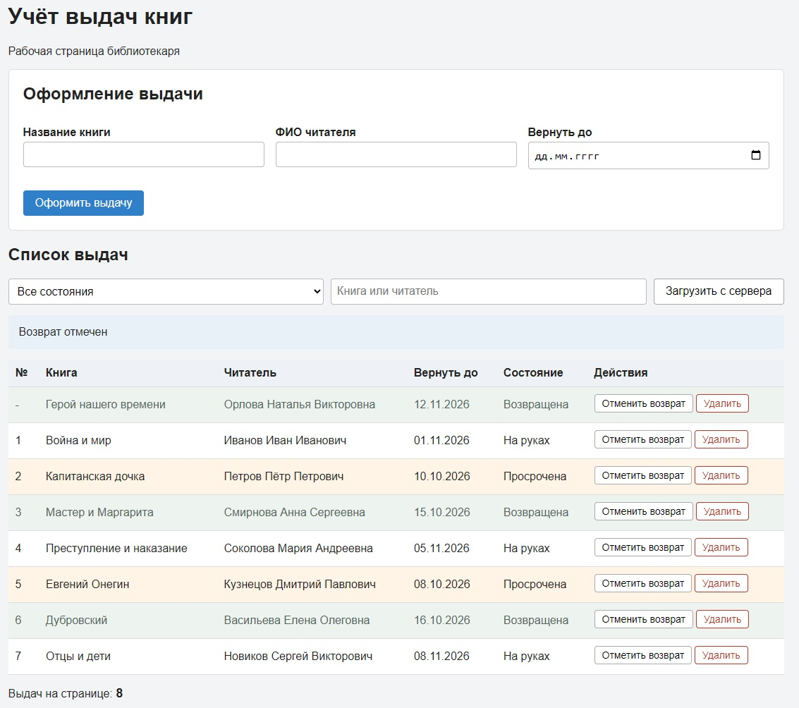
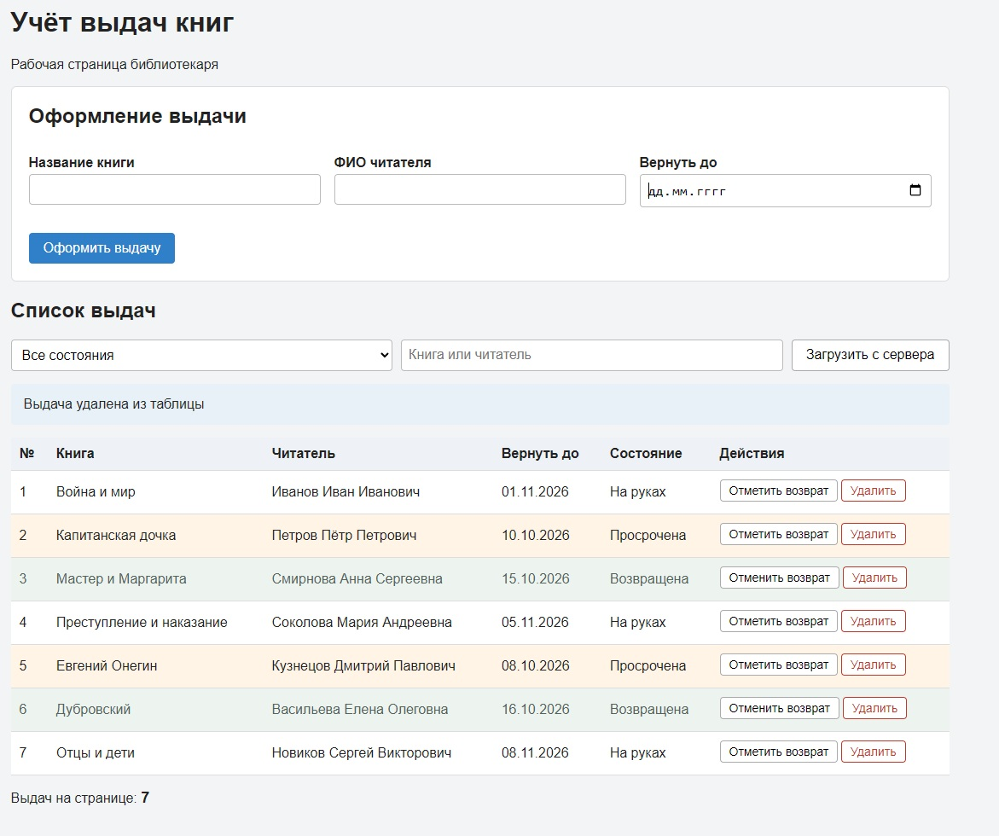
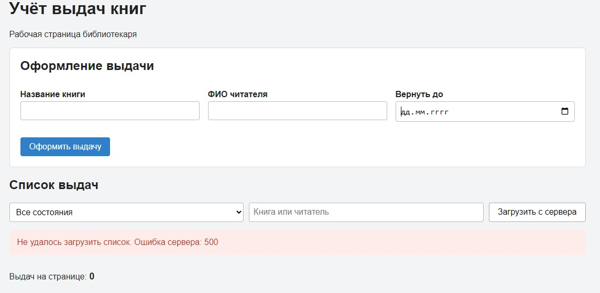

# Лабораторная работа №5
## Реализация клиентской логики

**Цель работы:** Реализовать обработку событий, изменение страницы средствами DOM и получение данных через Fetch.

## 1. Страница учёта выдач

Страница предназначена для библиотекаря. Она содержит форму выдачи, поиск, фильтр по состоянию и таблицу с кнопками возврата и удаления.

У выдачи есть номер, название книги, ФИО читателя, срок возврата и состояние. В учебных данных семь записей. Состояния «На руках», «Просрочена» и «Возвращена» заданы заранее и не рассчитываются по текущей дате.

Для запуска откройте файл src/index.html в браузере. Все необходимые файлы находятся в папке src. Установка дополнительных программ и сервера не требуется. 

## 2. Действия пользователя

| Событие | Элемент | Результат |
|---|---|---|
| `submit` | Форма выдачи | Проверка полей, добавление строки в начало таблицы и очистка формы. |
| `click` | «Загрузить с сервера» | Повторное получение учебных данных. |
| `change` | Фильтр состояния | Загрузка выдач с выбранным состоянием. |
| `input` | Поле поиска | Загрузка записей по введённому тексту. |
| `click` | «Отметить возврат» | Изменение состояния, оформления строки и подписи кнопки. Повторное нажатие отменяет отметку. |
| `click` | «Удалить» | Подтверждение и удаление строки, обновление счётчика. |

Название книги должно содержать не менее трёх символов. ФИО читателя и срок возврата обязательны. Ошибки выводятся под полями, страница при отправке формы не перезагружается.

Добавление, возврат и удаление меняют только текущую таблицу. Поиск, фильтр и повторная загрузка получают исходные записи из Mock API. Локальные изменения при этом сбрасываются. У новой строки вместо номера показан дефис.

## 3. Работа с DOM

Функция `createBorrowRow()` создаёт строку таблицы и кнопки с обработчиками. Для создания используются `createElement`, `appendChild` и `insertBefore`, для удаления используется `remove()`.

Текст записывается через `textContent`, поэтому введённые HTML-теги отображаются как текст. Атрибуты строки хранят номер и состояние выдачи. При отметке возврата меняются текст состояния, подпись и атрибут `title` кнопки, классы `returned` и `overdue`. Счётчик и атрибут `hidden` таблицы обновляются после добавления и удаления строк.

## 4. Получение данных

Функция `loadBorrows()` выполняет запрос `GET /api/borrows` с параметрами `status` и `q`. В `mock-data.js` находятся учебные записи и маршрут запроса. `mock-api.js` перехватывает Fetch и возвращает JSON с небольшой задержкой.

Ответ проверяется через `response.ok`. Функция `refreshList()` использует `try`, `catch` и `finally` и показывает четыре состояния:

* **Загрузка:** сообщение «Загрузка...», кнопка загрузки недоступна.
* **Данные получены:** таблица выдач и актуальный счётчик.
* **Пустой результат:** пояснение, скрытая таблица и счётчик 0.
* **Ошибка:** красное сообщение. Для ошибки сервера указан код ответа, для отсутствия сети показано «Нет связи с сервером».

## 5. Проверка работы

Страница проверена в Chrome при открытии через `file://` без отдельного сервера. Работа интерфейса также проверена во встроенном браузере через временный локальный HTTP-сервер.

| Проверка | Результат |
|---|---|
| Открытие страницы и повторная загрузка | Запуск через `file://` подтверждён в Chrome. Загружаются семь выдач, счётчик показывает 7. |
| Фильтр состояния | «На руках» показывает 3 записи, «Просрочена» 2, «Возвращена» 2. |
| Поиск и поиск вместе с фильтром | Находятся нужная книга или читатель. Поиск «Капитанская» с фильтром просрочки показывает одну выдачу. |
| Пустой результат | Сообщение «Выдачи не найдены», таблица скрыта, счётчик 0. |
| Пустая форма и короткое название | Под полями появляются подсказки, строка не добавляется. |
| Добавление кнопкой и клавишей Enter | Новая строка появляется сверху, счётчик увеличивается, форма очищается. Перезагрузки нет. |
| Возврат и отмена отметки | У возвращённых выдач сразу показана кнопка «Отменить возврат». Нажатие меняет состояние, подпись кнопки, её `title` и классы строки. У просроченной выдачи отмена отметки восстанавливает просрочку. |
| Удаление строки | Строка исчезает, счётчик уменьшается с 8 до 7. |
| Отмена удаления | После отмены в окне подтверждения запись остаётся в таблице, счётчик не меняется. Проверено в Chrome. |
| Текст `<b>Тест</b>` в названии | Отображается как обычный текст без создания HTML-элемента. |
| `MockApi.setDelay(2000, 3000)` | Во время загрузки видна подсказка, кнопка заблокирована. После ответа она снова доступна. |
| `MockApi.setErrorRate(1)` | Проверено в Chrome: красное сообщение «Не удалось загрузить список. Ошибка сервера: 500». Таблица скрыта. |
| Восстановление после ошибки сервера | После `MockApi.setErrorRate(0)` список снова загружается. Проверено в Chrome. |
| `MockApi.setNetworkDown(true)` | Сообщение «Нет связи с сервером». После включения сети повторная загрузка возвращает список. |
| Неверный адрес запроса | Показана ошибка 404, кнопка загрузки остаётся доступной. |

После проверки восстановлены правильный адрес запроса и обычный режим Mock API. В журнале браузера нет ошибок JavaScript. Синтаксис скриптов проверен, `mock-api.js` совпадает с исходным файлом преподавателя.

### Загруженный список

### Изменения таблицы

Добавлена выдача «Герой нашего времени» и отмечен её возврат. Перед этим удалена тестовая строка. Счётчик показывает восемь выдач.

### Ошибка загрузки

## Вывод

Реализована страница учёта выдач книг с обработкой событий, операциями с DOM и загрузкой данных через Fetch. Интерфейс обновляется без перезагрузки страницы.
